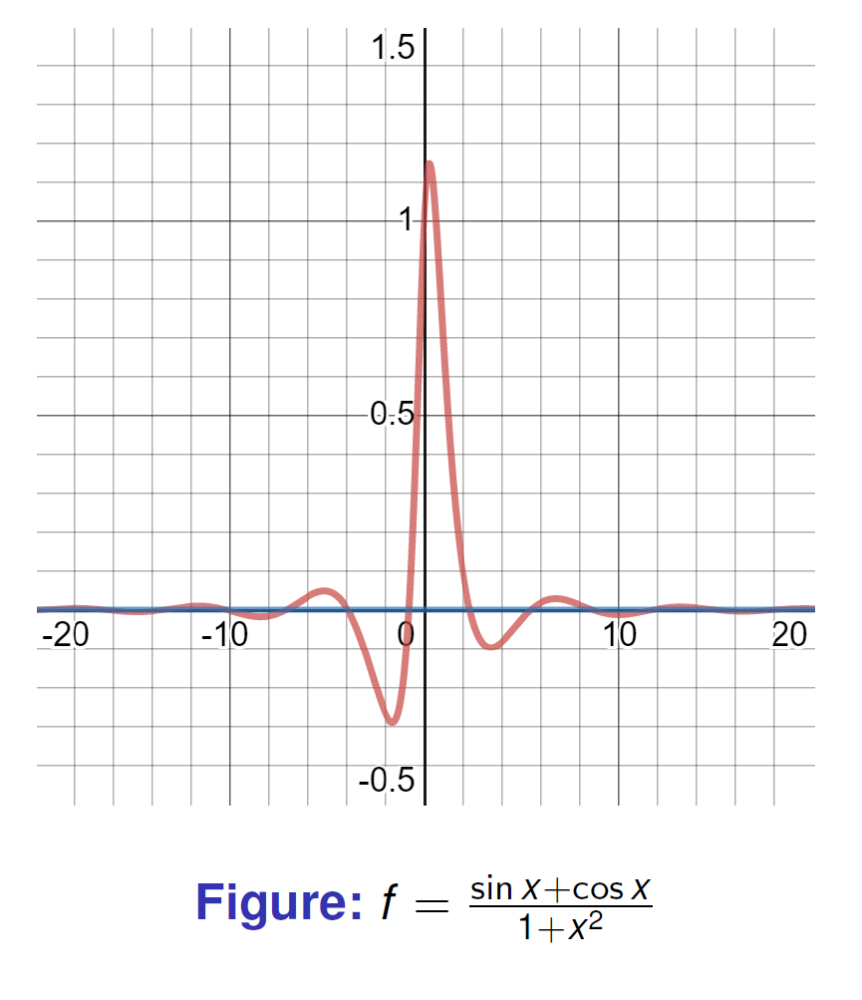
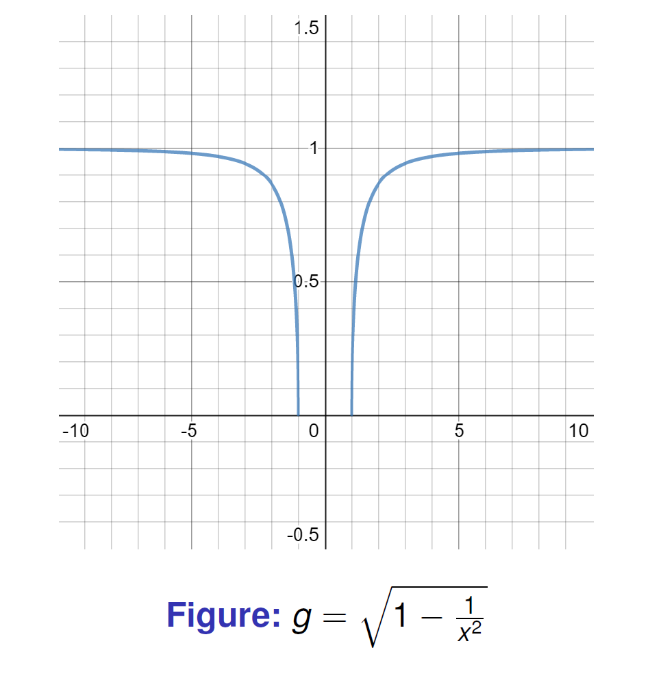
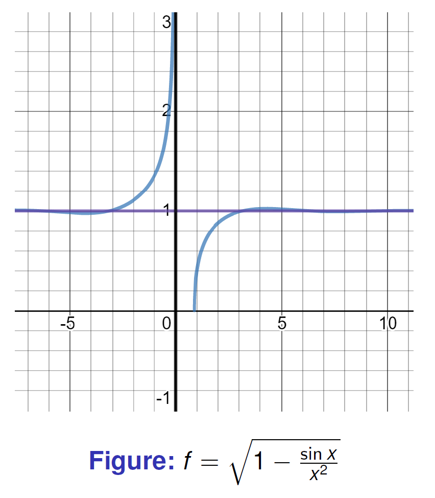
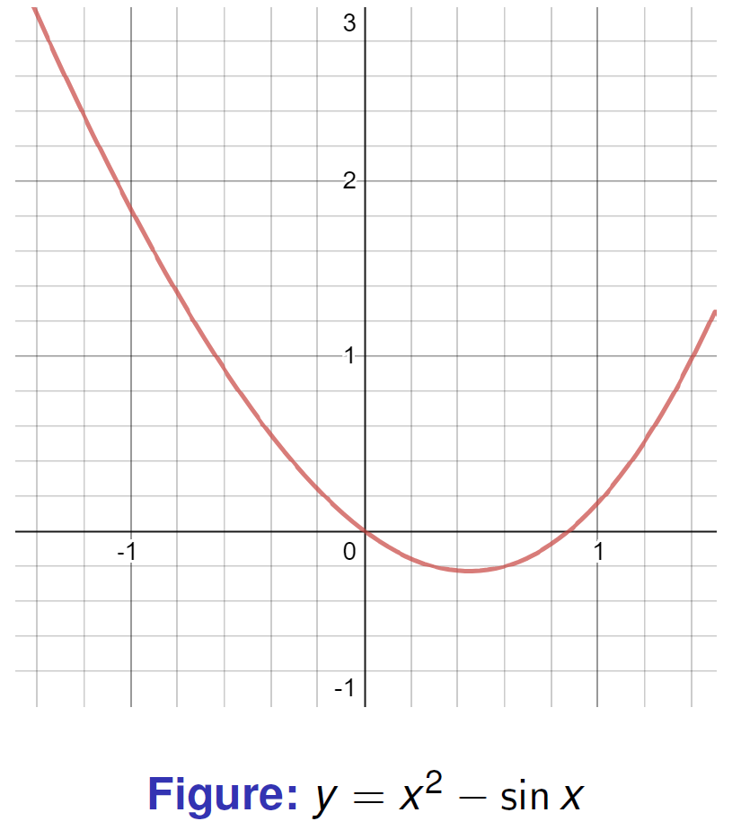
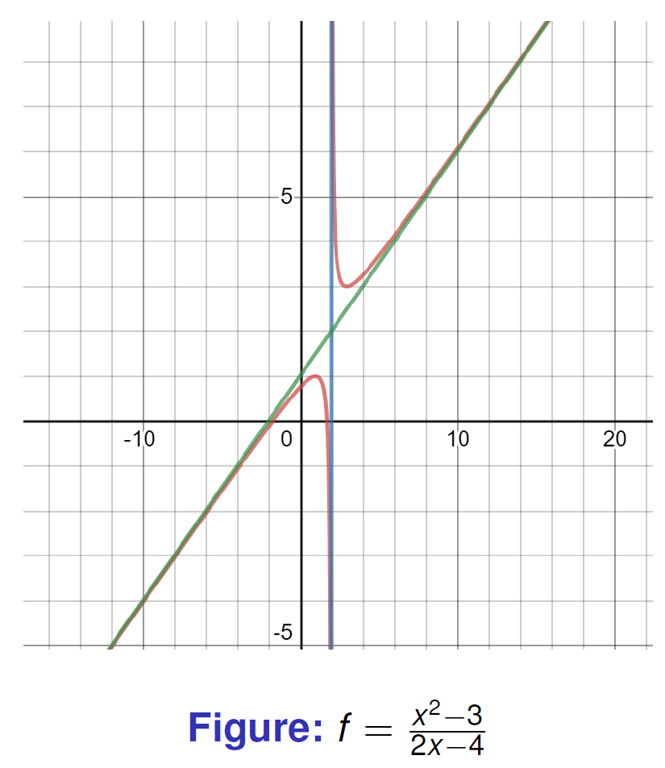
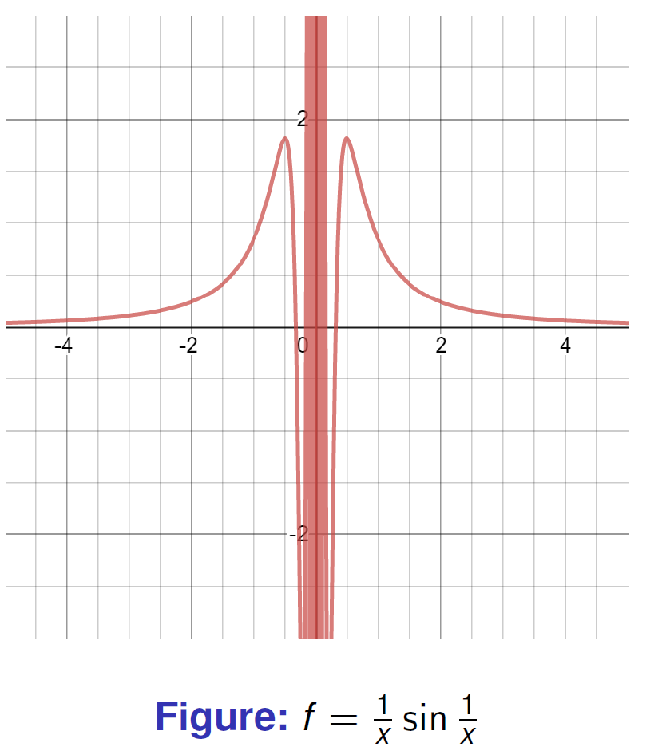

Week 1 supplied the definition of a limit. Here we use it in three settings: continuity on an interval, behavior at infinity, and sequences. The same estimates keep reappearing; what changes is whether we choose a radius around a point or a threshold beyond which the estimate holds.

# Tutorial 1: proof and quantifiers

## 1 Proof, logic, and limit language

### 1.1 Basic terminology

- An axiom is accepted as part of the framework in which we work.

- A theorem is established by proof; propositions and lemmas have the same logical status, with names that describe their role.

- A proof is a finite, logically valid argument using definitions, axioms and results already proved.

- In $P\Rightarrow Q$, $P$ is the hypothesis and $Q$ is the conclusion. The converse $Q\Rightarrow P$ requires its own proof.

### 1.2 The $\varepsilon$-$\delta$ definition

Here $\delta$ controls how close the input $x$ is to $x_0$, while $\varepsilon$ prescribes how close $f(x)$ must be to $\ell$.

A standard proof has the following shape:

1. Let $\varepsilon>0$ be arbitrary.

2. Choose an explicit $\delta>0$, usually after estimating $|f(x)-\ell|$ in terms of $|x-x_0|$.

3. Assume $0<|x-x_0|<\delta$ and verify $|f(x)-\ell|<\varepsilon$.

Working backward helps find a suitable radius, but the written proof should then run forward from that choice. A list of inequalities ending in a proposed $\delta$ is not yet the verification.

### 1.3 Direct proof, contradiction, and contraposition

#### Direct proof

To prove a statement of the form

$$
P\Rightarrow Q,
$$

assume that $P$ is true and use definitions, axioms, and previously proved results until $Q$ follows. This is the default method for most $\varepsilon$-$\delta$ arguments.

#### Proof by contradiction

To prove a statement $S$:

1.  Assume its negation, $\neg S$.

2.  Derive a contradiction, such as $R\land\neg R$, an impossible inequality, or a conflict with a known theorem.

3.  Conclude that $\neg S$ is false, so $S$ is true.

For a uniqueness statement, assume that two distinct objects both satisfy the defining property. For a nonexistence statement, assume that the object exists and use its required properties to obtain a contradiction.

#### Example: irrationality of $\sqrt2$

Suppose, for contradiction, that

$$
\sqrt2=\frac{p}{q},
$$

where $p,q$ are positive integers with no common factor. Squaring gives

$$
p^2=2q^2.
$$

Thus $p^2$ is even, so $p$ is even. Write $p=2r$. Substitution gives

$$
4r^2=2q^2
\quad\Longrightarrow\quad
q^2=2r^2.
$$

Therefore $q$ is also even. Hence $p$ and $q$ have the common factor $2$, contradicting the assumption that $p/q$ is in lowest terms. Consequently,

$$
\sqrt2\notin\mathbb{Q}.
$$

#### Proof by contraposition

To prove

$$
P\Rightarrow Q,
$$

it is enough to prove the logically equivalent statement

$$
\neg Q\Rightarrow\neg P.
$$

This method is especially useful when the negation of the conclusion gives more concrete information than the conclusion itself.

### 1.4 Mathematical induction

Let $P(n)$ be a statement for $n\in\mathbb{Z}_{>0}$. The principle of mathematical induction says that if:

1.  **Base case:** $P(1)$ is true;

2.  **Inductive step:** for every positive integer $n$, assuming $P(n)$ is true implies that $P(n+1)$ is true;

then $P(n)$ is true for every positive integer $n$.

In the inductive step, clearly state the **induction hypothesis** $P(n)$ before proving $P(n+1)$. Do not assume the statement that is being proved.

#### Example: sum of the first $n$ positive integers

We prove that

$$
1+2+\cdots+n=\frac{n(n+1)}{2}
\qquad(n\geq1).
$$

For $n=1$, both sides equal $1$. Now assume the formula holds for $n=k$:

$$
1+2+\cdots+k=\frac{k(k+1)}{2}.
$$

Then

$$
\begin{aligned}
1+2+\cdots+k+(k+1)
&=\frac{k(k+1)}{2}+(k+1)\\
&=\frac{(k+1)(k+2)}{2}.
\end{aligned}
$$

Thus, the statement for $k$ implies the statement for $k+1$, so the formula holds for every $n\geq1$.

#### Strong induction

The principle of strong induction replaces the induction hypothesis $P(n)$ by

$$
P(1),P(2),\ldots,P(n)\quad\Longrightarrow\quad P(n+1).
$$

It is useful when the case $n+1$ depends on several earlier cases rather than only on the immediately preceding case.

Ordinary induction, strong induction, and the well-ordering principle are equivalent principles. The well-ordering principle states that every nonempty subset of $\mathbb{Z}_{>0}$ has a least element.

# Lecture 5: continuous functions and intermediate values

## Composition and change of variable

**Continuity of a composition.** If $g(x)\to b$ as $x\to c$, and $f$ is continuous at $b$, with $f(g(x))$ defined near $c$, then

$$
\lim_{x\to c}f(g(x))=f(b).
$$

Given $\varepsilon>0$, continuity of $f$ gives an input tolerance $\eta>0$. The limit of $g$ then supplies $\delta$ such that $0<|x-c|<\delta$ implies $|g(x)-b|<\eta$, which in turn implies $|f(g(x))-f(b)|<\varepsilon$. If $g(x)=b$, continuity still covers that value.

If we assume only $f(t)\to A$ as $t\to b$, rather than continuity at $b$, we need $g(x)\ne b$ on a punctured neighborhood. For example, take $f(t)=1$ for $t\ne0$, $f(0)=0$, and $g(x)=0$. Then $f(t)\to1$ at zero, but $f(g(x))=0$.

A two-way substitution requires more than $u(t)\to c$. If $u$ is a continuous bijection between neighborhoods of $t_0$ and $c$, with $u(t_0)=c$ and continuous inverse, the two compositions give

$$
\lim_{x\to c}f(x)=A\quad\Longleftrightarrow\quad
\lim_{t\to t_0}f(u(t))=A.
$$

Squaring near zero is not such a change of variable on a two-sided interval: it loses the negative side.

## The Intermediate Value Theorem

If $f$ is continuous on $[a,b]$, every value between $f(a)$ and $f(b)$ is attained at some point in $[a,b]$. In particular, opposite signs at the endpoints imply a zero in $(a,b)$.

The theorem gives existence, not uniqueness. A sign change is sufficient, not necessary: $x^2$ has a zero without changing sign. Continuity is essential; a step function can jump across zero without taking the value zero.

## Exercise 1.1.26

Any polynomial of odd degree with real coefficients has at least one real root.

### Proof

Let

$$
P(x)=\sum_{k=0}^{n}a_kx^k
$$

be a polynomial of degree $n$ with real coefficients, where $n$ is an odd integer and $a_n\neq0$. Without loss of generality, assume that $a_n>0$. If $a_n<0$, we can apply the same argument to $-P$.

Let

$$
C=\max_{0\leq k\leq n-1}|a_k|.
$$

For $|x|\geq1$, we have

$$
\begin{aligned}
\left|P(x)-a_nx^n\right|
&=\left|\sum_{k=0}^{n-1}a_kx^k\right|\\
&\leq C\sum_{k=0}^{n-1}|x|^k\\
&\leq Cn|x|^{n-1}
=\frac{Cn}{|a_n||x|}|a_nx^n|.
\end{aligned}
$$

Choose

$$
R>\max\left\{1,\frac{2Cn}{|a_n|}\right\}.
$$

Then, whenever $|x|\geq R$,

$$
\left|P(x)-a_nx^n\right|<\frac12|a_nx^n|.
$$

Since $n$ is odd, $R^n>0$ and $(-R)^n<0$. For $x=R$, we obtain

$$
\begin{aligned}
P(R)
&\geq a_nR^n-\left|P(R)-a_nR^n\right|\\
&>a_nR^n-\frac12|a_nR^n|
=\frac12a_nR^n>0.
\end{aligned}
$$

For $x=-R$, we obtain

$$
\begin{aligned}
P(-R)
&\leq a_n(-R)^n+\left|P(-R)-a_n(-R)^n\right|\\
&<a_n(-R)^n+\frac12|a_n(-R)^n|
=\frac12a_n(-R)^n<0.
\end{aligned}
$$

Thus,

$$
P(-R)<0<P(R).
$$

Because $P$ is continuous on $[-R,R]$, the Intermediate Value Theorem gives some $c\in[-R,R]$ such that

$$
P(c)=0.
$$

Therefore, $P$ has at least one real root. $\square$

### Proof of the Intermediate Value Theorem

Let $f$ be continuous on $[a,b]$, and suppose first that

$$
f(a)<y_0<f(b).
$$

Define

$$
S=\{x\in[a,b]:f(x)\leq y_0\}.
$$

The set $S$ is nonempty because $a\in S$, and it is bounded above by $b$. By the completeness of $\mathbb{R}$, the supremum

$$
c=\sup S
$$

exists. Continuity at $a$ gives a short interval $[a,a+\eta]$ on which $f<y_0$; continuity at $b$ gives a short interval $[b-\eta,b]$ on which $f>y_0$, after reducing $\eta>0$ if needed. Thus $a+\eta\le c\le b-\eta$, so $a<c<b$. This is the endpoint step needed before using a two-sided neighborhood of $c$.

We claim that $f(c)=y_0$. Suppose first that $f(c)<y_0$. By continuity of $f$ at $c$, there exists $\delta>0$ such that

$$
|x-c|<\delta\quad\Longrightarrow\quad f(x)<y_0.
$$

Choosing $x>c$ sufficiently close to $c$ gives $x\in S$, contradicting the fact that $c$ is an upper bound of $S$.

On the other hand, suppose that $f(c)>y_0$. By continuity of $f$ at $c$, there exists $\delta>0$ such that

$$
|x-c|<\delta\quad\Longrightarrow\quad f(x)>y_0.
$$

Since $c=\sup S$, there is some $x\in S$ with $c-\delta<x\leq c$. This contradicts $f(x)>y_0$.

Therefore neither $f(c)<y_0$ nor $f(c)>y_0$ is possible, and hence

$$
f(c)=y_0.
$$

If $y_0=f(a)$ or $y_0=f(b)$, the conclusion is immediate by taking $c=a$ or $c=b$. If $f(b)<f(a)$, apply the same argument to $-f$. Therefore, for every value $y_0$ between $f(a)$ and $f(b)$, there exists $c\in[a,b]$ such that

$$
f(c)=y_0.
$$

# Lecture 6: infinity and asymptotes

## Limits Involving Infinity

### Finite limits as $x\to+\infty$

We say that

$$
\lim_{x\to+\infty}f(x)=L
$$

if, for every $\varepsilon>0$, there exists $M>0$ such that

$$
x>M\quad\Longrightarrow\quad |f(x)-L|<\varepsilon.
$$

In words, $f(x)$ becomes arbitrarily close to $L$ when $x$ is sufficiently large.

Similarly,

$$
\lim_{x\to-\infty}f(x)=L
$$

if, for every $\varepsilon>0$, there exists $M<0$ such that

$$
x<M\quad\Longrightarrow\quad |f(x)-L|<\varepsilon.
$$

### Examples

For the reciprocal function,

$$
\lim_{x\to+\infty}\frac{1}{x}=0,
\qquad
\lim_{x\to-\infty}\frac{1}{x}=0.
$$

Indeed, if $|x|>1/\varepsilon$, then

$$
\left|\frac{1}{x}-0\right|=\frac{1}{|x|}<\varepsilon.
$$

For a rational function whose numerator has lower degree than its denominator,

$$
\lim_{x\to\pm\infty}\frac{P(x)}{Q(x)}=0,
\qquad \deg P<\deg Q.
$$

### Infinite limits as $x\to c$

We write

$$
\lim_{x\to c}f(x)=+\infty
$$

if, for every $A>0$, there exists $\delta>0$ such that

$$
0<|x-c|<\delta
\quad\Longrightarrow\quad
f(x)>A.
$$

Similarly,

$$
\lim_{x\to c}f(x)=-\infty
$$

if, for every $B>0$, there exists $\delta>0$ such that

$$
0<|x-c|<\delta
\quad\Longrightarrow\quad
f(x)<-B.
$$

For example,

$$
\lim_{x\to0}\frac{1}{x^2}=+\infty,
$$

because $1/x^2$ can be made larger than any prescribed positive number by choosing $x$ sufficiently close to $0$, with $x\neq0$.

### Infinite limits as $x\to\pm\infty$

The notation

$$
\lim_{x\to+\infty}f(x)=+\infty
$$

means that for every $A>0$, there exists $M>0$ such that

$$
x>M\quad\Longrightarrow\quad f(x)>A.
$$

The other cases are defined analogously. For instance, if $n$ is odd and $a_n>0$, then

$$
\lim_{x\to+\infty}a_nx^n=+\infty,
\qquad
\lim_{x\to-\infty}a_nx^n=-\infty.
$$

## Exercise 1.1.30

### (a)

Prove, using the $N$-$\delta$ language, that

$$
\lim_{x\to0^+}\frac{1}{\sqrt[3]{x}}=+\infty.
$$

### (b)

Find the limit

$$
\lim_{x\to+\infty}\left(\sqrt{x+1}-\sqrt{x-1}\right),
$$

and prove your result using the $\varepsilon$-$N$ language.

### Solution

#### (a)

Let $N>0$ be arbitrary. Choose

$$
\delta=\frac{1}{N^3}.
$$

If $0<x<\delta$, then

$$
\sqrt[3]{x}<\sqrt[3]{\delta}=\frac{1}{N}.
$$

Therefore,

$$
\frac{1}{\sqrt[3]{x}}>\frac{1}{\sqrt[3]{\delta}}=N.
$$

Hence, for every $N>0$, there exists $\delta>0$ such that

$$
0<x<\delta
\quad\Longrightarrow\quad
\frac{1}{\sqrt[3]{x}}>N.
$$

Thus,

$$
\boxed{\displaystyle\lim_{x\to0^+}\frac{1}{\sqrt[3]{x}}=+\infty}.
$$

#### (b)

Let

$$
f(x)=\sqrt{x+1}-\sqrt{x-1}.
$$

For $x\geq1$, rationalizing gives

$$
f(x)
=\frac{(x+1)-(x-1)}{\sqrt{x+1}+\sqrt{x-1}}
=\frac{2}{\sqrt{x+1}+\sqrt{x-1}}.
$$

Since $\sqrt{x+1}+\sqrt{x-1}\to+\infty$ as $x\to+\infty$, we obtain

$$
\lim_{x\to+\infty}f(x)=0.
$$

To prove this using the $\varepsilon$-$N$ language, let $\varepsilon>0$ be given. Choose

$$
N=1+\frac{1}{\varepsilon^2}.
$$

If $x>N$, then $x>1$ and

$$
0<f(x)
=\frac{2}{\sqrt{x+1}+\sqrt{x-1}}
\leq\frac{1}{\sqrt{x-1}}.
$$

Moreover, $x>N$ implies $x-1>1/\varepsilon^2$, so

$$
\left|f(x)-0\right|=f(x)
\leq\frac{1}{\sqrt{x-1}}<\varepsilon.
$$

Therefore, for every $\varepsilon>0$, there exists $N>0$ such that

$$
x>N\quad\Longrightarrow\quad
\left|\sqrt{x+1}-\sqrt{x-1}\right|<\varepsilon.
$$

Hence,

$$
\boxed{\displaystyle
\lim_{x\to+\infty}\left(\sqrt{x+1}-\sqrt{x-1}\right)=0}.
$$

## Exercise 1.1.28

All the Limit Laws remain true when we replace

$$
\lim_{x\to c}
$$

by

$$
\lim_{x\to+\infty}
\quad\text{or}\quad
\lim_{x\to-\infty}.
$$

For example, if

$$
\lim_{x\to+\infty}f(x)=L,
\qquad
\lim_{x\to+\infty}g(x)=M,
$$

then

$$
\lim_{x\to+\infty}(f(x)+g(x))=L+M,
$$

and, provided $M\neq0$,

$$
\lim_{x\to+\infty}\frac{f(x)}{g(x)}=\frac{L}{M}.
$$

The same statements hold as $x\to-\infty$.

## Asymptotes

The graph of $y=f(x)$ on an interval $I$ is

$$
\{(x,y):x\in I,\ y=f(x)\}.
$$

A line is an asymptote when the graph approaches it along an unbounded branch. For horizontal and oblique lines we let $x$ tend to an infinity. For a vertical line $x=a$, we require a one-sided infinite limit of $f$ at $a$. Merely having $x\to a$ is not enough: an ordinary point of a curve is not a vertical asymptote.

### Horizontal asymptotes

A line $y=b$ is a horizontal asymptote of $y=f(x)$ as $x\to+\infty$ if

$$
\lim_{x\to+\infty}f(x)=b.
$$

Similarly, $y=b$ is a horizontal asymptote as $x\to-\infty$ if

$$
\lim_{x\to-\infty}f(x)=b.
$$

#### Example 1.1.32

Find the horizontal asymptotes of

$$
f(x)=\frac{\sin x+\cos x}{1+x^2},
$$

and

$$
g(x)=\sqrt{1-\frac{1}{x^2}},\qquad |x|\geq1.
$$

Since $|\sin x+\cos x|\leq2$,

$$
\left|\frac{\sin x+\cos x}{1+x^2}\right|
\leq\frac{2}{1+x^2}\longrightarrow0.
$$

Thus, $y=0$ is a horizontal asymptote of $f$ as $x\to\pm\infty$.

For $g$,

$$
\lim_{x\to\pm\infty}g(x)
=\sqrt{1-\lim_{x\to\pm\infty}\frac1{x^2}}
=1.
$$

Thus, $y=1$ is a horizontal asymptote of $g$ as $x\to\pm\infty$.

### Sketches of horizontal asymptotes

{width=65%}

{width=65%}

### Vertical asymptotes

A line $x=a$ is a vertical asymptote of $y=f(x)$ as $x\to a^+$ if

$$
\lim_{x\to a^+}f(x)=+\infty
\quad\text{or}\quad
\lim_{x\to a^+}f(x)=-\infty.
$$

The analogous definition applies as $x\to a^-$. In the notation $\pm\infty$, the sign may be either $+$ or $-$.

#### Example 1.1.33

Consider

$$
h(x)=\sqrt{1-\frac{\sin x}{x^2}},
$$

on its domain

$$
(-\infty,0)\cup[a,+\infty),
$$

where the boundary point $a>0$ is determined by

$$
a^2=\sin a,
$$

where $0<a<1$. As $x\to0^-$, we have $\sin x\sim x$, and therefore

$$
1-\frac{\sin x}{x^2}
\sim 1-\frac1x\longrightarrow+\infty.
$$

Consequently,

$$
\lim_{x\to0^-}h(x)=+\infty,
$$

so $x=0$ is a vertical asymptote. Near $x=a$ from the right, the expression under the square root approaches $0$, so $x=a$ is not a vertical asymptote.

This example emphasizes that a domain endpoint is not automatically a vertical asymptote: the function itself must tend to $\pm\infty$.

### Sketches of vertical asymptotes

{width=65%}

{width=65%}

### Oblique asymptotes

A line

$$
y=ax+b,\qquad a\neq0,
$$

is an oblique asymptote of $y=f(x)$ as $x\to+\infty$ if

$$
\lim_{x\to+\infty}[f(x)-ax-b]=0.
$$

The definition as $x\to-\infty$ is analogous.

When the limits exist, the coefficients can be found from

$$
a=\lim_{x\to\pm\infty}\frac{f(x)}{x},
\qquad
b=\lim_{x\to\pm\infty}[f(x)-ax].
$$

#### Example 1.1.34

Find the oblique asymptote of

$$
f(x)=\frac{x^2-3}{2x-4}.
$$

Polynomial division gives

$$
\begin{aligned}
f(x)
&=\frac{x^2-4+1}{2(x-2)}\\
&=\frac12(x+2)+\frac{1}{2(x-2)}.
\end{aligned}
$$

Therefore,

$$
f(x)-\left(\frac{x}{2}+1\right)
=\frac{1}{2(x-2)}\longrightarrow0
\qquad(x\to\pm\infty).
$$

The oblique asymptote is

$$
y=\frac{x}{2}+1.
$$

Also, $x=2$ is a vertical asymptote.

{width=65%}

#### Example 1.1.35

Let

$$
f(x)=\frac{x^3}{(x+2)(x-1)}.
$$

The vertical asymptotes are

$$
x=-2,\qquad x=1.
$$

For the oblique asymptote,

$$
\frac{f(x)}{x}
=\frac{x^2}{(x+2)(x-1)}\longrightarrow1,
$$

and

$$
f(x)-x
=\frac{-x^2+2x}{(x+2)(x-1)}\longrightarrow-1.
$$

Hence the oblique asymptote is

$$
y=x-1
$$

as $x\to\pm\infty$.

{width=65%}

## Exercise 1.1.36

Let

$$
f(x)=\frac1x\sin\frac1x.
$$

Does the graph of $f$ have a vertical asymptote at $x=0$? Explain your answer using the definition of a vertical asymptote.

Since

$$
\left|\frac1x\sin\frac1x\right|\leq\frac1{|x|},
$$

this estimate alone does not determine an infinite limit. To see the oscillation explicitly, define

$$
x_n=\frac{1}{\frac{\pi}{2}+2\pi n},
\qquad
y_n=\frac{1}{\frac{3\pi}{2}+2\pi n}.
$$

Then $x_n,y_n\to0^+$ and

$$
f(x_n)=\frac{\pi}{2}+2\pi n\longrightarrow+\infty,
$$

while

$$
f(y_n)=-\left(\frac{3\pi}{2}+2\pi n\right)\longrightarrow-\infty.
$$

Thus, as $x\to0^+$, the function tends neither to $+\infty$ nor to $-\infty$. Applying the same argument to $-x_n$ and $-y_n$ gives the same conclusion as $x\to0^-$. Therefore, $x=0$ is not a vertical asymptote in the usual one-sided sense.

{width=65%}

## More Exercises

Find the limits and use the $\varepsilon$-$N$ language to prove your results.

### (a)

$$
\lim_{x\to+\infty}\sqrt{x}\left(\sqrt{x+1}-\sqrt{x-1}\right).
$$

### (b)

$$
\lim_{x\to+\infty}
\frac{\sqrt{x+\sqrt{x+\sqrt{x}}}}{\sqrt{x+1}}.
$$

**Solution to (a).** Rationalizing and dividing the denominator by $\sqrt{x}$ gives

$$
A(x)=\frac{2}{\sqrt{1+1/x}+\sqrt{1-1/x}}\longrightarrow1.
$$

For $x\ge2$, write $S=\sqrt{1+1/x}+\sqrt{1-1/x}\ge1$. Rationalizing each difference from $1$ shows $|S-2|\le2/x$, so $|A(x)-1|\le2/x$. The choice $N=\max\{2,2/\varepsilon\}$ verifies the limit directly.

**Solution to (b).** The denominator is outside the outer radical, as in Lecture 6, p.32. Put

$$
B(x)=\sqrt{\frac{x+\sqrt{x+\sqrt{x}}}{x+1}},\qquad x\ge1.
$$

Then $B(x)\to1$. To obtain a threshold rather than only a formal calculation, use

$$
|B(x)-1|
=\frac{\sqrt{x+\sqrt{x}}-1}{(x+1)(B(x)+1)}
\le\frac{\sqrt{2x}}{x+1}\le\frac{\sqrt2}{\sqrt{x}}.
$$

Thus $N=\max\{1,2/\varepsilon^2\}$ works. Moving the denominator inside the radical would change the problem.

# Lecture 7: sequences and completeness

## 1.7 Sequences and limits

### Definition 1.1.12 (Limit of a sequence)

A sequence $\{a_n\}$ converges to $L$ if for every $\varepsilon>0$ there exists an integer $N$ such that

$$
n>N \quad\Longrightarrow\quad |a_n-L|<\varepsilon.
$$

If no such number $L$ exists, we say that the sequence diverges.

We write

$$
\lim_{n\to\infty}a_n=L,
\qquad\text{or}\qquad a_n\to L.
$$

### Exercise 1.1.39

Show that if a sequence converges, then the limit is unique.

#### Proof

Suppose that

$$
a_n\to L_1,
\qquad a_n\to L_2.
$$

Let $\varepsilon>0$ be arbitrary. Then there exist $N_1,N_2$ such that

$$
n>N_1 \Rightarrow |a_n-L_1|<\varepsilon/2,
$$

and

$$
n>N_2 \Rightarrow |a_n-L_2|<\varepsilon/2.
$$

For $n>\max\{N_1,N_2\}$,

$$
|L_1-L_2|
\le |a_n-L_1|+|a_n-L_2|
< \varepsilon.
$$

Since this holds for every $\varepsilon>0$, we must have $L_1=L_2$.

Hence the limit is unique.

### Example 1.1.40

Investigate the convergence or divergence of the following sequences.

#### (a) $(-1)^n$

This sequence alternates between $-1$ and $1$, so it does not approach any single number. Therefore,

$$
(-1)^n\text{ diverges.}
$$

#### (b) $\displaystyle \frac{\sin n-n^2}{n^3+1}$

Since

$$
\frac{\sin n-n^2}{n^3+1}
=
\frac{\sin n}{n^3+1}-\frac{n^2}{n^3+1},
$$

and both terms go to $0$, we have

$$
\lim_{n\to\infty}\frac{\sin n-n^2}{n^3+1}=0.
$$

#### (c) $\displaystyle \frac{(-1)^{[\sqrt n]}}{n}$

Here $[\sqrt n]$ is the integer part of $\sqrt n$, and the numerator is always $\pm1$. Since dividing by $n$ makes the magnitude go to $0$,

$$
\lim_{n\to\infty}\frac{(-1)^{[\sqrt n]}}{n}=0.
$$

## Bounded sequences

### Definition

A sequence $\{a_n\}$ is called:

- bounded above if there exists a constant $M$ such that $a_n\le M$ for all $n$;

- bounded below if there exists a constant $m$ such that $a_n\ge m$ for all $n$;

- bounded if there exists a constant $C>0$ such that $|a_n|\le C$ for all $n$.

Equivalently, $\{a_n\}$ is bounded iff there exist $m,M$ with

$$
m\le a_n\le M \qquad \forall n\ge1.
$$

### Theorem

Every convergent sequence is bounded.

#### Proof

If $a_n\to L$, then for $\varepsilon=1$ there exists $N$ such that

$$
n>N \Rightarrow |a_n-L|<1.
$$

Thus for all $n>N$,

$$
|a_n|\le |L|+1.
$$

Let

$$
C=\max\{|a_1|,\dots,|a_N|,|L|+1\}.
$$

Then $|a_n|\le C$ for all $n$, so the sequence is bounded.

## Divergence to infinity

### Definition

We say that $a_n\to +\infty$ if for every real number $M$ there exists an integer $N$ such that

$$
n\ge N \Rightarrow a_n>M.
$$

We say that $a_n\to -\infty$ if for every real number $m>0$ there exists an integer $N$ such that

$$
n\ge N\Rightarrow a_n<-m.
$$

### Example 1.1.41

Investigate the behavior of the following sequences as $n\to\infty$.

#### (a) $(-1)^n n$

This sequence alternates sign and grows in magnitude, so it is unbounded and does not converge to a finite limit. It also does not tend to $+\infty$ or $-\infty$ in the usual sense because the signs alternate.

#### (b) $a^n/n!$ with $a>0$

For fixed $a>0$, set $b_n=a^n/n!$. For $n$ large enough,

$$
\frac{b_{n+1}}{b_n}=\frac{a}{n+1}\le\frac12.
$$

Hence $b_{N+k}\le b_N2^{-k}\to0$. This gives a proof of the statement that a factorial eventually dominates a fixed exponential:

$$
\frac{a^n}{n!}\to0.
$$

#### (c) $n^n/n!$

Since

$$
\frac{n^n}{n!}=\prod_{k=1}^n\frac{n}{k},
$$

the factors with $k\le\lfloor n/2\rfloor$ are at least $2$, and all remaining factors are at least $1$. Consequently

$$
\frac{n^n}{n!}\ge2^{\lfloor n/2\rfloor}\longrightarrow+\infty.
$$

In particular,

$$
\frac{n^n}{n!}\to +\infty.
$$

## Limit laws for sequences

If

$$
\lim_{n\to\infty}a_n=A,
\qquad
\lim_{n\to\infty}b_n=B,
$$

then the following hold:

1.  $\displaystyle \lim_{n\to\infty}(a_n+b_n)=A+B$;

2.  $\displaystyle \lim_{n\to\infty}(a_n-b_n)=A-B$;

3.  $\displaystyle \lim_{n\to\infty}(k a_n)=kA$ for any constant $k$;

4.  $\displaystyle \lim_{n\to\infty}(a_n b_n)=AB$;

5.  if $B\neq0$, then

$$
\lim_{n\to\infty}\frac{a_n}{b_n}=\frac{A}{B}.
$$

## Exercise 1.1.43

Let $\{a_n\}$ and $\{b_n\}$ be convergent sequences and assume $a_n\ge b_n$ for all sufficiently large $n$. Prove that

$$
\lim_{n\to\infty}a_n\ge \lim_{n\to\infty}b_n.
$$

### Proof

Let

$$
A=\lim_{n\to\infty}a_n,
\qquad B=\lim_{n\to\infty}b_n.
$$

Suppose, for contradiction, that $A<B$. Set

$$
\varepsilon=\frac{B-A}{2}>0.
$$

Then there exists $N$ such that for all $n>N$,

$$
|a_n-A|<\varepsilon,
\qquad |b_n-B|<\varepsilon.
$$

Hence for $n>N$,

$$
a_n<A+\varepsilon=\frac{A+B}{2},
$$

and

$$
b_n>B-\varepsilon=\frac{A+B}{2}.
$$

So $a_n<b_n$ for all sufficiently large $n$, contradicting the assumption that $a_n\ge b_n$ eventually. Therefore,

$$
A\ge B.
$$

## Exercise 1.1.43 (continued)

Assume $a_n\le b_n\le c_n$ for all $n\ge N_0$ and

$$
\lim_{n\to\infty}a_n = \lim_{n\to\infty}c_n = L.
$$

Then

$$
\lim_{n\to\infty}b_n = L.
$$

### Proof

Let $\varepsilon>0$ be given. Since $a_n\to L$ and $c_n\to L$, there exist $N_1,N_2$ such that

$$
n>N_1 \Rightarrow |a_n-L|<\varepsilon,
$$

and

$$
n>N_2 \Rightarrow |c_n-L|<\varepsilon.
$$

Let $N=\max\{N_0,N_1,N_2\}$. Then for all $n>N$,

$$
L-\varepsilon<a_n\le b_n\le c_n<L+\varepsilon.
$$

Hence

$$
|b_n-L|<\varepsilon,
$$

for all $n>N$. Therefore, $b_n\to L$.

This is the sequence version of the Sandwich Theorem.

## Exercise 1.1.44

Let $\{a_n\}$ be a sequence with $a_n\to L$, and let $f$ be a function continuous at $L$ and defined at all $a_n$. Then

$$
f(a_n)\to f(L).
$$

### Proof

Let $\varepsilon>0$ be given. Since $f$ is continuous at $L$, there exists $\delta>0$ such that

$$
|x-L|<\delta \Rightarrow |f(x)-f(L)|<\varepsilon.
$$

Because $a_n\to L$, there exists $N$ such that

$$
n>N \Rightarrow |a_n-L|<\delta.
$$

Therefore, for all $n>N$,

$$
|f(a_n)-f(L)|<\varepsilon.
$$

So $f(a_n)\to f(L)$.

## Proposition 1.1.13 (function limits and sequence limits)

Let $I$ be an interval containing $x_0$ in its interior and let $f$ be defined on $I\setminus\{x_0\}$. Then

$$
\lim_{x\to x_0}f(x)=A
$$

exists if and only if for every sequence $\{a_n\}\subset I\setminus\{x_0\}$ with $a_n\to x_0$, the limit

$$
\lim_{n\to\infty}f(a_n)
$$

exists and equals $A$.

### Proof

- If $f(x)\to A$, fix $\varepsilon>0$ and take its limit radius $\delta$. Since $a_n\to x_0$ with $a_n\ne x_0$, eventually $0<|a_n-x_0|<\delta$. Hence $|f(a_n)-A|<\varepsilon$.

- Conversely, suppose the function limit were not $A$. Negating the definition supplies $\varepsilon_0>0$ such that every radius contains a point violating the error bound. For each $n$, choose $x_n$ with $0<|x_n-x_0|<1/n$ and $|f(x_n)-A|\ge\varepsilon_0$. Then $x_n\to x_0$ but $f(x_n)$ does not converge to $A$, a contradiction.

The version in the lecture says only that $f(a_n)$ converges for every admissible sequence. The common value then follows too: if two sequences gave different limits, interleaving them would produce an admissible sequence whose image does not converge.

Thus, the limit of a function can be tested using sequences.

## Exercise 1.1.45

Let $f$ be a function defined on $[M,\infty)$. Prove:

### (a)

$$
\lim_{x\to\infty}f(x)=L
$$

if and only if for every sequence $a_n\to\infty$,

$$
\lim_{n\to\infty}f(a_n)=L.
$$

### (b)

$$
\lim_{x\to\infty}f(x)=+\infty
$$

if and only if for every sequence $a_n\to\infty$,

$$
\lim_{n\to\infty}f(a_n)=+\infty.
$$

**Proof.** The forward implications follow directly from the threshold definitions. If the finite limit fails, there are $\varepsilon_0>0$ and points $x_n>\max\{M,n\}$ with $|f(x_n)-L|\ge\varepsilon_0$. If the infinite limit fails, there are a fixed bound $A>0$ and points $x_n>\max\{M,n\}$ with $f(x_n)\le A$. In either case $x_n\to\infty$ contradicts the corresponding hypothesis about all sequences.

## 1.8 Least upper bound and greatest lower bound

### Definition

Let $\{a_n\}$ be a sequence bounded above. A number $L$ is called the least upper bound, or supremum, of $\{a_n\}$ if:

1.  $a_n\le L$ for all $n$;

2.  if $M$ is any upper bound, then $L\le M$.

We write

$$
L=\sup_{n\ge1}a_n.
$$

Similarly, if $\{a_n\}$ is bounded below, a number $l$ is called the greatest lower bound, or infimum, if:

1.  $a_n\ge l$ for all $n$;

2.  if $m$ is any lower bound, then $l\ge m$.

We write

$$
l=\inf_{n\ge1}a_n.
$$

### Remarks

- For the supremum: for every $\varepsilon>0$, there exists $n$ such that

$$
a_n>L-\varepsilon.
$$

- For the infimum: for every $\varepsilon>0$, there exists $n$ such that

$$
a_n<l+\varepsilon.
$$

### Theorem 1.1.15

Any sequence bounded above has a supremum, and any sequence bounded below has an infimum.

This is the completeness property of the real numbers.

## Example 1.1.47

Find the infimum and supremum of the following sequences.

### (a) $\left\{(-1)^n/n\right\}_{n\ge1}$

$$
\inf=-1,\qquad \sup=\frac12.
$$

The first term is $-1$, so an infimum of $-1/2$ would already fail to be a lower bound. The odd-indexed terms increase from $-1$ toward zero; the even-indexed terms decrease from $1/2$ toward zero. Both extremal values are attained.

### (b) $\{(-1)^n n\}_{n\ge1}$

This sequence is unbounded above and below, so

$$
\sup=+\infty,
\qquad\inf=-\infty.
$$

### (c) $\{n^{(-1)^n}\}_{n\ge1}$

This is a power, not the product in (b). Even indices give $a_{2k}=2k$, whereas odd indices give $a_{2k-1}=1/(2k-1)$. Therefore

$$
\sup=+\infty,
\qquad\inf=0.
$$

There is no minimum: every term is positive, but the odd subsequence tends to zero. The product $n(-1)^n$ in the original transcription is the same sequence as (b), whose extended bounds are $-\infty$ and $+\infty$.

### (d) $a_1=\sqrt2$, $a_{n+1}=\sqrt{2+a_n}$

Induction gives $0<a_n<2$: if $a_n<2$, then $a_{n+1}=\sqrt{2+a_n}<2$. Also $a_2>a_1$, and monotonicity of the square root propagates $a_{n+1}>a_n$. An increasing, bounded sequence converges: if $L=\sup\{a_n\}$, then for every $\varepsilon>0$ some term exceeds $L-\varepsilon$, and all later terms remain between $L-\varepsilon$ and $L$.

Only after proving convergence do we pass to the limit in the recurrence. Continuity of the square root gives the positive solution of

$$
x=\sqrt{2+x},
$$

namely

$$
x^2-x-2=0 \Rightarrow x=2.
$$

Thus,

$$
\sup=2,
\qquad\inf=\sqrt2.
$$

## What a bound does, and does not, tell us

A supremum concerns all terms, including the first few; a limit ignores any finite initial segment. For instance, changing $a_1$ to $100$ changes the supremum but not a pre-existing limit. Boundedness alone does not imply convergence, as $(-1)^n$ shows. Monotonicity is the extra hypothesis in the theorem used for the radical recurrence.

## Review problems

1. Explain why the IVT cannot establish uniqueness of a root. Identify where completeness enters its proof.

2. Find both asymptotes of $(x^2-3)/(2x-4)$, and explain why a function can cross a horizontal or oblique asymptote.

3. Compare $(-1)^n n$, $n^{(-1)^n}$ and $(-1)^n/n$: determine boundedness, convergence, infimum and supremum separately.

4. Prove the radical recurrence stays below $2$ before attempting to solve its limiting equation.

## Lecture sources

Xing-Bin Pan, MAT1011 lecture slides: Lecture 5 (continuity of compositions and intermediate values), Lecture 6 (infinite limits and asymptotes; the nested-radical exercise is on p.32), Lecture 7 (sequences, pp.3–33; completeness and Example 1.1.47, pp.34–41). Tutorial 1 supplies the proof-language section. Differentiation begins in Week 3.
