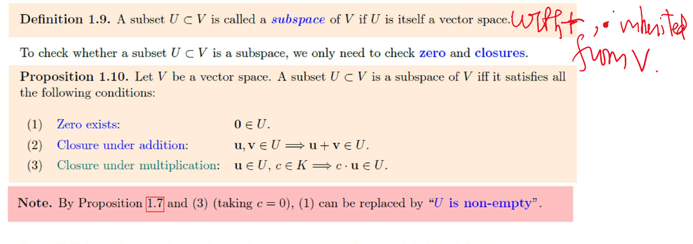

## 7 Sept. / Linear equations

$A=(a_{ij})\in M_{m\times n}(\mathbb R)$: $m$ rows, $n$ columns. Column vectors throughout.
$$
\sum_{j=1}^n a_{ij}x_j=b_i\quad\longleftrightarrow\quad Ax=b,
\qquad[A\mid b]\in M_{m\times(n+1)}.
$$
**Notation.**
$$
\begin{aligned}
(A^T)_{ij}&=a_{ji},\quad A^T\in M_{n\times m},& I_n&=(\delta_{ij}),\\
(A+B)_{ij}&=a_{ij}+b_{ij},&(cA)_{ij}&=ca_{ij}.
\end{aligned}
$$
Upper triangular: $a_{ij}=0$ for $i>j$; lower: $i<j$; diagonal: $i\ne j$.

**Row operations.**
$$
R_i\leftrightarrow R_j,\qquad R_i\leftarrow cR_i\ (c\ne0),\qquad
R_i\leftarrow R_i+cR_j\ (i\ne j).
$$
All reversible $\Rightarrow$ same solutions. Operate on the right-hand side too.

**REF.** Zero rows last; leading $1$'s move right down the rows. RREF: pivot columns zero elsewhere. This lecture takes pivots to be $1$.

**Solving.** Eliminate $\to$ back substitute. For $n$ variables and $r$ coefficient pivots:
$$
\begin{array}{c|c}
[0\ \cdots\ 0\mid1]\text{ occurs}&\text{no solution}\\
\text{consistent},\ r=n&\text{unique}\\
\text{consistent},\ r<n&n-r\text{ free variables}
\end{array}
$$

**Ex.** Nonzero rows of the echelon system:
$$
\begin{aligned}
x_1-x_2+4x_3+5x_4+4x_5&=0,\\
x_3+2x_4+6x_5&=1,\qquad x_5=3.
\end{aligned}
$$
$x_2=s$, $x_4=t$ $\Rightarrow x_3=-17-2t$, $x_1=56+s+3t$.
$$
x=\begin{pmatrix}56\\0\\-17\\0\\3\end{pmatrix}
+s\begin{pmatrix}1\\1\\0\\0\\0\end{pmatrix}
+t\begin{pmatrix}3\\0\\-2\\1\\0\end{pmatrix},\qquad s,t\in\mathbb R.
$$
**Ex.** $3x_1-9x_2=4$, $-2x_1+6x_2=h$ $\Rightarrow 0=h+8/3$.
Consistent iff $h=-8/3$; then $(x_1,x_2)=(4/3+3t,t)$.

**Theorem.** Homogeneous, $n>m$ $\Rightarrow$ nonzero solutions:
$$
x=0\text{ solves it},\qquad n-r\ge n-m>0.
$$
At least one free variable. Square RREF with $n$ pivots $=I_n$.

\newpage

## 9 Sept. (I) / Inverse and LU

$(AB)_{ij}=\sum_k a_{ik}b_{kj}$; $(m\times n)(n\times p)\to m\times p$.

**Inverse.** $AA^{-1}=A^{-1}A=I$; square $A$ only.
$$
A\text{ invertible}\iff Ax=b\text{ has exactly one solution for every }b.
$$
Row-reduce $[A\mid I]\to[Q\mid E]$: $Q=I\Rightarrow A^{-1}=E$; otherwise no inverse.

Why: $E=E_k\cdots E_1$ (elementary matrices), $EA=I$.
Each $E_i$ invertible $\Rightarrow A=E^{-1}\Rightarrow AE=I$ too.
$$
\begin{aligned}
(AB)^{-1}&=B^{-1}A^{-1},&(A^T)^{-1}&=(A^{-1})^T,\\
(B^{-1}A^{-1})(AB)&=I,&(A^{-1})^TA^T&=(AA^{-1})^T=I.
\end{aligned}
$$
Other product orders similarly. Inverses reverse order.

**Theorem.** Triangular + nonzero diagonal $\Rightarrow$ inverse triangular of the same type.

Upper case: solve $Ax=e_j$ backwards. $i>j\Rightarrow x_i=0$; division only by $a_{ii}\ne0$. These $x$'s form $A^{-1}$.

**LU.** Elimination without row swaps:
$$
E_k\cdots E_1A=U
\quad\Rightarrow\quad
A=LU,\quad L=E_1^{-1}\cdots E_k^{-1}.
$$
$L$: unit lower triangular; elimination multipliers below the diagonal.

**Ex.** Opening matrix from *The Nine Chapters*:
$$
A=\begin{pmatrix}3&2&1\\2&3&1\\1&2&3\end{pmatrix},\qquad
\begin{aligned}
R_2&\leftarrow R_2-\tfrac23R_1,\\
R_3&\leftarrow R_3-\tfrac13R_1,\\
R_3&\leftarrow R_3-\tfrac45R_2.
\end{aligned}
$$
$$
A=\underbrace{\begin{pmatrix}1&0&0\\2/3&1&0\\1/3&4/5&1\end{pmatrix}}_L
\underbrace{\begin{pmatrix}3&2&1\\0&5/3&1/3\\0&0&12/5\end{pmatrix}}_U.
$$
$Ax=b$: first $Ld=b$ (forwards), then $Ux=d$ (backwards).
$$
b=\begin{pmatrix}39\\34\\26\end{pmatrix}
\Rightarrow d=\begin{pmatrix}39\\8\\33/5\end{pmatrix}
\Rightarrow x=\begin{pmatrix}37/4\\17/4\\11/4\end{pmatrix}.
$$
With swaps: $PA=LU$, so $Ld=Pb$, $Ux=d$. Slides' $A=PLU$ uses the inverse permutation.

Factor once $O(n^3)$; each new $b$: $O(n^2)$. Reuse $L,U$ rather than form $A^{-1}$.

\newpage

## 9 Sept. (II) / Fields; vector spaces

**Def.1.1.** Field $K$: $(K,+)$, $(K\setminus\{0\},\cdot)$ abelian groups + distributivity; $0\ne1$.

Examples: $\mathbb Q,\mathbb R,\mathbb C$, $\mathbb Q(\sqrt2)$, $\mathbb R(t)$, $\mathbb F_p$ ($p$ prime).
$\mathbb Z/6\mathbb Z$ fails: $2\cdot3=0$.

**Def.1.4.** Vector space over $K$: addition $V\times V\to V$, scalar multiplication $K\times V\to V$; for $u,v,w\in V$, $c,d\in K$,
$$
\begin{aligned}
u+v&=v+u,&(u+v)+w&=u+(v+w),\\
u+0&=u,&u+(-u)&=0,\\
(cd)u&=c(du),&1u&=u,\\
c(u+v)&=cu+cv,&(c+d)u&=cu+du.
\end{aligned}
$$
$0\in V$ and negatives must exist. Scalars $\in K$; vectors $\in V$.

**Prop.1.5--7.** Unique zero, unique negative; cancellation; $cu=0\iff c=0$ or $u=0$.
$$
\begin{aligned}
0'&=0'+0=0,\\
u',u''\text{ negatives of }u:\quad
u'&=u'+(u+u'')=(u'+u)+u''=u'',\\
0u=(0+0)u=0u+0u&\Rightarrow0u=0,\\
c0=c(0+0)=c0+c0&\Rightarrow c0=0,\\
cu=0,\ c\ne0&\Rightarrow u=c^{-1}(cu)=0.
\end{aligned}
$$
Cancellation: add $-u$. Also $u+(-1)u=(1-1)u=0\Rightarrow(-1)u=-u$.

**Examples.** $\{0\}$, $K^n$, $M_{m\times n}(K)$, $K[t]$. Over $\mathbb R$: $C^0(\mathbb R)$; $\{f:f''+f=0\}$, since
$$
(af+bg)''+(af+bg)=a(f''+f)+b(g''+g)=0.
$$
$\mathbb C$ over $\mathbb R$: yes. $\mathbb R$ over $\mathbb C$: no, $i\cdot1\notin\mathbb R$.

**Non-examples (usual operations).**

- $x,y\ge0$: multiplying $(1,0)$ by $-1$ leaves the set.
- Invertible matrices; degree exactly $n$; $f(0)=1$: zero missing.
- A line not through $0$: same obstruction.

\newpage

## Subspaces; span

{width=90%}

*9 Sept., vector spaces, p.13.*

**Test.** $U\ne\varnothing$ and $au+bv\in U$ for all $u,v\in U$, $a,b\in K$.
Identities inherited from $V$; $-u=(-1)u\in U$.

Examples: $x+y+z=0$ in $\mathbb R^3$; $K_n[t]$ (degree $\le n$, including $0$); $\{f:f(0)=0\}$.
$\mathbb R^2$ itself is not a subset of $\mathbb R^3$; $\{(x,y,0)^T\}$ is.

**Null space.** $A\in M_{m\times n}(K)$:
$$
\operatorname{Nul}(A)=\{x\in K^n:Ax=0\}\le K^n,
\qquad A(au+bv)=aAu+bAv=0.
$$
**Def.1.11.** $\operatorname{Span}(S)=\{\text{finite linear combinations of vectors in }S\}$;
$\operatorname{Span}(\varnothing)=\{0\}$.

**Thm.1.12.** $\operatorname{Span}(S)$ is a subspace, the smallest one containing $S$. In particular $\operatorname{Span}(U)=U$ for a subspace $U$.

Proof: add/scale combinations; still finite combinations. Any subspace containing $S$ contains all of them.
$$
u_i=\sum_j a_{ij}v_j\quad\Rightarrow\quad
\sum_i c_i u_i=\sum_j\left(\sum_i c_i a_{ij}\right)v_j.
$$
**Ex.1.27.**
$$
\begin{pmatrix}a-3b\\b-a\\a\\b\end{pmatrix}
=a\begin{pmatrix}1\\-1\\1\\0\end{pmatrix}
+b\begin{pmatrix}-3\\1\\0\\1\end{pmatrix}.
$$
$a,b\in\mathbb R$ arbitrary $\Rightarrow U=\operatorname{Span}\{(1,-1,1,0)^T,(-3,1,0,1)^T\}\le\mathbb R^4$.

**Back to equations.** If $Ax_p=b$,
$$
Ax=b\iff A(x-x_p)=0
\iff x\in x_p+\operatorname{Nul}(A).
$$
Homogeneous: subspace. Inhomogeneous: translate; $b\ne0\Rightarrow0$ not a solution.
