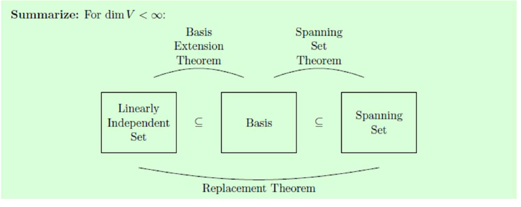

## 14 Sept. / Four spaces; independence

$A\in M_{m\times n}(K)$:
$$
\begin{array}{c|c}
\text{subspaces of }K^n&\text{subspaces of }K^m\\\hline
\operatorname{Nul}(A)=\{x:Ax=0\}&\operatorname{Nul}(A^T)\\
\operatorname{Row}(A)=\operatorname{Span}\{\text{rows}\}
&\operatorname{Col}(A)=\operatorname{Span}\{\text{columns}\}
\end{array}
$$
$A(au+bv)=aAu+bAv$: null spaces closed. Spans are subspaces (wk1).
$$
\operatorname{Row}(UA)\subseteq\operatorname{Row}(A),\qquad
\operatorname{Col}(AB)\subseteq\operatorname{Col}(A).
$$
Rows/columns of the product are combinations of the originals. If $U,B$ invertible, equality: apply $U^{-1},B^{-1}$ for the reverse inclusion.

**Finitely generated:** $V=\operatorname{Span}(v_1,\ldots,v_r)$ for some finite list.
$K^n$, $K_n[t]$: yes. $C^0(\mathbb R)$: no ($1,x,\ldots,x^N$ independent for every $N$).

**Def.1.14--15.**
$$
v_1,\ldots,v_r\text{ independent}
\iff \left[\sum_i c_iv_i=0\Rightarrow c_1=\cdots=c_r=0\right].
$$
Dependent: a nonzero coefficient list gives zero. Equivalently, some $v_k$ lies in the span of the others:
$$
\sum_i c_iv_i=0,\quad c_k\ne0
\quad\Rightarrow\quad v_k=-\sum_{i\ne k}\frac{c_i}{c_k}v_i.
$$
Singleton: independent iff $v\ne0$. Pair: dependent iff one is a multiple of the other. Any list containing $0$: dependent.

**Ex.1.33--35.** Explicit relations:
$$
\begin{aligned}
\begin{pmatrix}1\\2\\3\end{pmatrix}
-2\begin{pmatrix}4\\5\\6\end{pmatrix}
+\begin{pmatrix}7\\8\\9\end{pmatrix}&=0,\\
t^2-4t+(4t-t^2)&=0,\\
\sin2x-2\sin x\cos x&=0.
\end{aligned}
$$
**Ex.1.36 / field matters.** $\{\sin x,\cos x,e^{ix}\}$, as complex-valued functions:
$$
e^{ix}-\cos x-i\sin x=0\quad\Rightarrow\quad\text{dependent over }\mathbb C.
$$
Real coefficients: imaginary parts force the $e^{ix}$ coefficient to vanish; evaluate at $0,\pi/2$ for the other two. Independent over $\mathbb R$.

\newpage

## Bases; coordinates

**Def.1.16.** Basis $\mathcal B=(b_1,\ldots,b_n)$: independent + spanning.
Standard bases: $(e_1,\ldots,e_n)$ for $K^n$; $(1,t,\ldots,t^n)$ for $K_n[t]$.

**Thm.1.17 / remove redundant vectors.** For finite $S$,
$$
v_k\in\operatorname{Span}(S\setminus\{v_k\})
\Rightarrow\operatorname{Span}(S)=\operatorname{Span}(S\setminus\{v_k\}).
$$
Substitute the expression for $v_k$ into each combination. Repeat until independent $\Rightarrow$ a basis remains. Minimal spanning set = basis; $\{0\}$ has empty basis.

**Thm.1.18--19 / unique coordinates.**
$$
\mathcal B\text{ basis}\iff
\forall v\in V\ \exists!\,(c_1,\ldots,c_n):\quad v=\sum_i c_ib_i,
\qquad[v]_{\mathcal B}=\begin{pmatrix}c_1\\\vdots\\c_n\end{pmatrix}.
$$
Uniqueness: subtract two expressions; independence gives $c_i-c_i'=0$.
Conversely, existence gives spanning; uniqueness for $0$ gives independence.

**Ex.1.39.** $p=t^3+2t^2+3t+4$, $\mathcal E=(1,t,t^2,t^3)$:
$$
[p]_{\mathcal E}=(4,3,2,1)^T.
$$
Order matters. Invertible $n\times n$ matrix: columns form a basis of $K^n$, since $Ax=b$ has a unique solution for every $b$.

**Computing bases.** Row-reduce $A\to R$.

- $\operatorname{Row}(A)$: nonzero rows of $R$ (independent by successive pivot columns).
- $\operatorname{Col}(A)$: pivot columns of the **original $A$**; alternatively row-reduce $A^T$.
- $\operatorname{Nul}(A)$: solve $Rx=0$, one vector per free parameter.

Row operations preserve relations among columns: $Ac=0\iff Rc=0$. They need not preserve the column space itself.

**Ex. / null basis.**
$$
A=\begin{pmatrix}1&-1&4&5&4\\0&0&1&2&6\\0&0&0&0&1\end{pmatrix},\qquad
\begin{cases}x_5=0,\\x_3=-2t,\\x_2=s,\ x_4=t,\\x_1=s+3t.\end{cases}
$$
$$
x=s\underbrace{\begin{pmatrix}1\\1\\0\\0\\0\end{pmatrix}}_{v_1}
+t\underbrace{\begin{pmatrix}3\\0\\-2\\1\\0\end{pmatrix}}_{v_2}.
$$
$\{v_1,v_2\}$ spans the null space; coordinates $2,4$ force independence. Hence a basis.

\newpage

## 16 Sept. / Dimension

**Thm.1.20 / replacement.** $V=\operatorname{Span}(v_1,\ldots,v_n)$ and $u_1,\ldots,u_m$ independent $\Rightarrow m\le n$.

Proof via equations: write $u_i=\sum_j a_{ji}v_j$. If $m>n$,
$$
\sum_{i=1}^m a_{ji}x_i=0\quad(j=1,\ldots,n)
\Rightarrow\exists x\ne0
\Rightarrow\sum_{i=1}^m x_iu_i=0,
$$
contradiction. $n$ homogeneous equations, $m>n$ unknowns.

**Thm.1.21--22.** Two finite bases: apply replacement both ways $\Rightarrow$ same size. Define
$$
\dim_K V=|\mathcal B|,\qquad \dim\{0\}=0.
$$
Not finitely generated: $\dim V=\infty$ (lecture convention).
$$
\begin{array}{c|c@{\qquad}c|c}
V&\dim_K V&V&\dim_K V\\\hline
K^n&n&K_n[t]&n+1\\
M_{m\times n}(K)&mn&K[t]&\infty
\end{array}
$$
$x+y+z=0$ in $\mathbb R^3$: basis $(1,-1,0)^T,(1,0,-1)^T$, dimension $2$.
$\dim_{\mathbb R}\mathbb C=2$, $\dim_{\mathbb C}\mathbb C=1$; $\dim_{\mathbb Q}\mathbb R=\infty$.

**Thm.1.23 / extend independent vectors.** $\dim V=n<\infty$, $U\subseteq V$ a subspace. Any independent list in $U$ extends to a basis of $U$; $\dim U\le n$.

If not spanning, choose $u\in U\setminus\operatorname{Span}(S)$. Then $S\cup\{u\}$ stays independent. Repeat; replacement stops the process by $n$ vectors.

**Cor.1.24.** $U\subseteq V$, finite dimensions equal $\Rightarrow U=V$. Otherwise extend a basis of $U$ by one more vector in $V$.

**Thm.1.25.** If $|S|=\dim V=n$, then
$$
S\text{ independent}\iff S\text{ basis}\iff S\text{ spanning}.
$$
Extend / delete; no room to add / remove. The count $n$ is essential.

{width=68%}

*16 Sept., p.11. Extend independent sets; trim spanning sets.*

$\mathbb R^3$ subspaces: $\{0\}$, lines through $0$, planes through $0$, $\mathbb R^3$.

\newpage

## Rank; turning a row space into equations

**Definitions.** Row rank $=\dim\operatorname{Row}(A)$; column rank $=\dim\operatorname{Col}(A)$; nullity $=\dim\operatorname{Nul}(A)$.

With $r$ pivots, $n$ columns:
$$
\dim\operatorname{Row}(A)=\dim\operatorname{Col}(A)=r,\qquad
\dim\operatorname{Nul}(A)=n-r.
$$
Nonzero echelon rows / original pivot columns / free-parameter vectors give the respective bases.

**Ex. / 16 Sept., pp.12--13.** For $A$ as printed:
$$
A=\begin{pmatrix}
1&-1&1&5&4\\
1&-1&5&7&10\\
2&-2&8&10&9\\
3&-3&13&17&19\\
0&0&2&4&13
\end{pmatrix}
\sim
\begin{pmatrix}
1&-1&0&0&0\\
0&0&1&0&0\\
0&0&0&1&0\\
0&0&0&0&1\\
0&0&0&0&0
\end{pmatrix}.
$$
Four pivots, not three. The slide's echelon matrix and null basis do not match this $A$.
$$
\begin{aligned}
\mathcal B_{\rm row}&=\{(1,-1,0,0,0),\ e_3^T,e_4^T,e_5^T\},\\
\mathcal B_{\rm null}&=\{(1,1,0,0,0)^T\},\\
\mathcal B_{\rm col}&=\{A_{\cdot1},A_{\cdot3},A_{\cdot4},A_{\cdot5}\}.
\end{aligned}
$$
Also $\operatorname{Nul}(A^T)=\operatorname{Span}\{(0,-1,-1,1,0)^T\}$: row $4=$ row $2+$ row $3$.

Find $B$ with $\operatorname{Nul}(B)=\operatorname{Row}(A)$. Take the null-basis vector as a row:
$$
B=\begin{pmatrix}1&1&0&0&0\end{pmatrix},\qquad BA^T=0.
$$
Hence $\operatorname{Row}(A)\subseteq\operatorname{Nul}(B)$, and
$$
\dim\operatorname{Row}(A)=4=5-1=\dim\operatorname{Nul}(B)
\Rightarrow\operatorname{Row}(A)=\operatorname{Nul}(B).
$$
Here both are simply $\{y\in\mathbb R^5:y_1+y_2=0\}$.

\newpage

## Direct sums

**Def.1.26--28.** $U,W$ subspaces of $V$:
$$
U+W=\{u+w:u\in U,w\in W\}=\operatorname{Span}(U\cup W).
$$
$U\cap W$ and $U+W$ are subspaces (closure). Direct sum means
$$
V=U\oplus W\quad\iff\quad V=U+W,\quad U\cap W=\{0\}.
$$
**Thm.1.29.** Direct sum $\iff$ every $v\in V$ has a unique decomposition $v=u+w$.
$$
u+w=u'+w'\Rightarrow u-u'=w'-w\in U\cap W=\{0\}.
$$
Conversely, $z\in U\cap W\Rightarrow z=z+0=0+z\Rightarrow z=0$ by uniqueness.

**Ex.1.48--51.**
$$
\begin{aligned}
\mathbb R^3&=\operatorname{Span}(e_1,e_2)\oplus\operatorname{Span}(e_3),\\
K[t]&=K\cdot1\oplus\{p:p(0)=0\},
&p(t)&=p(0)+[p(t)-p(0)],\\
f(x)&=\underbrace{\frac{f(x)+f(-x)}2}_{\text{even}}
+\underbrace{\frac{f(x)-f(-x)}2}_{\text{odd}},\\
A&=\underbrace{\frac{A+A^T}2}_{\text{symmetric}}
+\underbrace{\frac{A-A^T}2}_{\text{skew-symmetric}}.
\end{aligned}
$$
Last two over $\mathbb R$ (more generally, characteristic $\ne2$). Intersections zero: even + odd forces $f=-f$; symmetric + skew forces $A=-A$.

**Thm.1.30 / complement.** $\dim V<\infty$, $U\subseteq V$ a subspace $\Rightarrow\exists W$ with $V=U\oplus W$.
$$
\underbrace{(u_1,\ldots,u_r)}_{\text{basis of }U}
\ \longrightarrow\
\underbrace{(u_1,\ldots,u_r,w_1,\ldots,w_s)}_{\text{basis of }V},
\qquad W=\operatorname{Span}(w_1,\ldots,w_s).
$$
Spanning gives $V=U+W$; independence gives $U\cap W=\{0\}$. Complement not unique:
$$
\mathbb R^2=\operatorname{Span}(e_1)\oplus\operatorname{Span}(e_2)
=\operatorname{Span}(e_1)\oplus\operatorname{Span}(e_1+e_2).
$$
Infinite-dimensional versions: existence of bases / complements uses the Axiom of Choice.
