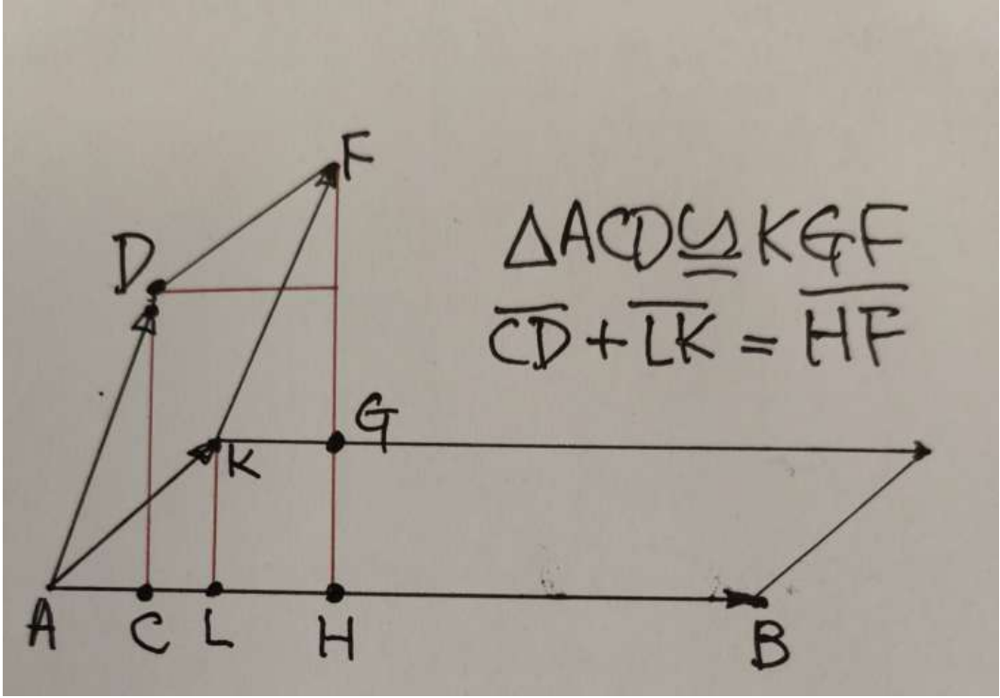

## 12 Oct. / Rank; change of basis

$T:V\to W$, finite dimensions:
$$
r\le\min\{\dim V,\dim W\},\qquad
r+\dim\ker T=\dim V.
$$
Full rank means $r=\min\{\dim V,\dim W\}$. $T(x)=b$: solvable iff $b\in\operatorname{Im}T$; then solutions $=x_p+\ker T$.

**Thm.2.32.** For square $A\in M_n(K)$, equivalent:
$$
\begin{aligned}
A\text{ invertible}&\iff\operatorname{rank}A=n\iff\operatorname{rref}(A)=I_n\\
&\iff\ker A=\{0\}\iff\operatorname{Col}(A)=K^n\\
&\iff\text{columns of }A\text{ form a basis of }K^n.
\end{aligned}
$$

**Thm.2.33--35.** Ordered bases $\mathcal B=(b_i)$, $\mathcal C=(c_i)$:
$$
P^{\mathcal B}_{\mathcal C}
=\bigl([b_1]_{\mathcal C}\ \cdots\ [b_n]_{\mathcal C}\bigr),
\qquad [v]_{\mathcal C}=P^{\mathcal B}_{\mathcal C}[v]_{\mathcal B}.
$$
Source upstairs, target downstairs. It is the identity map in two coordinate systems.
$$
\left(P^{\mathcal B}_{\mathcal C}\right)^{-1}=P^{\mathcal C}_{\mathcal B},\qquad
P^{\mathcal C}_{\mathcal D}P^{\mathcal B}_{\mathcal C}=P^{\mathcal B}_{\mathcal D}.
$$
For bases of $K^n$, put $S_{\mathcal B}=(b_1\ \cdots\ b_n)$ in standard coordinates. Then
$$
v=S_{\mathcal B}[v]_{\mathcal B}=S_{\mathcal C}[v]_{\mathcal C}
\quad\Rightarrow\quad P^{\mathcal B}_{\mathcal C}=S_{\mathcal C}^{-1}S_{\mathcal B}.
$$

**Ex.2.23.** $\mathcal B=((1,1)^T,(1,-1)^T)$, $\mathcal C=((1,0)^T,(1,1)^T)$:
$$
P^{\mathcal B}_{\mathcal C}
=\begin{pmatrix}1&1\\0&1\end{pmatrix}^{-1}
\begin{pmatrix}1&1\\1&-1\end{pmatrix}
=\begin{pmatrix}0&2\\1&-1\end{pmatrix}.
$$
Column check: $b_1=c_2$, $b_2=2c_1-c_2$.

## Similar matrices

**Thm.2.36--37.** $A=[T]_{\mathcal B}$, $B=[T]_{\mathcal C}$, $Q=P^{\mathcal B}_{\mathcal C}$:
$$
BQ=QA\quad\Rightarrow\quad B=QAQ^{-1}.
$$
Same linear map, different bases. Similarity is an equivalence relation; rank and trace are unchanged. The converse from these invariants alone is false.

\newpage

## A nicer basis; determinant axioms

**Ex.2.24.** In standard coordinates,
$$
A=\frac15\begin{pmatrix}14&-2\\-2&11\end{pmatrix},\qquad
S=\begin{pmatrix}1&-2\\2&1\end{pmatrix},\qquad
AS=S\begin{pmatrix}2&0\\0&3\end{pmatrix}.
$$
Thus $[T]_{\mathcal B}=S^{-1}AS=\operatorname{diag}(2,3)$ for $\mathcal B=((1,2)^T,(-2,1)^T)$.
Here $S$ sends **new coordinates to standard coordinates**, so the inverse is on the left.

**Multilinear:** linear in each slot separately, holding the others fixed.
$$
F(\ldots,au+bv,\ldots)=aF(\ldots,u,\ldots)+bF(\ldots,v,\ldots).
$$
Symmetric: swaps leave $F$ unchanged. Alternating: repeated inputs give zero; a swap changes sign. The swap-sign rule alone implies alternating when $\operatorname{char}K\ne2$.

Example: $F(u,v)=u^TMv$ is bilinear; symmetric for $M^T=M$, alternating for skew-symmetric $M$ over $\mathbb R$ or $\mathbb C$.

**Def.3.1.** $\det(a_1,\ldots,a_n)$ is multilinear and alternating in its columns, normalized by $\det I_n=1$.
$$
\begin{aligned}
\det(\ldots,ca_i,\ldots)&=c\det A,\\
\det(\ldots,a_i+ca_j,\ldots,a_j,\ldots)&=\det A\quad(i\ne j),\\
\det(\ldots,a_j,\ldots,a_i,\ldots)&=-\det A.
\end{aligned}
$$
Dependent columns $\Rightarrow\det A=0$: express one column through the others; every expanded term has a repetition.

**Prop.3.2.** Triangular $A$: $\det A=\prod_i a_{ii}$. Also $\det(cA)=c^n\det A$; scaling the whole matrix scales every column.

**Geometry over $\mathbb R$.** Determinant = oriented volume; ordinary volume $=|\det A|$. For a fixed base, signed heights add:

{width=43%}

*14 Oct., p.26. $CD+LK=HF$: area additivity in one slot.*

\newpage

## 14 Oct. / Existence and uniqueness

**Permutations.** $S_n$: bijections of $\{1,\ldots,n\}$. A transposition swaps two entries; every permutation is a product of transpositions. Its parity is well-defined:
$$
\operatorname{sgn}(\sigma)=(-1)^{\#\text{ transpositions}},\qquad
\operatorname{sgn}(\sigma\tau)=\operatorname{sgn}(\sigma)\operatorname{sgn}(\tau).
$$
**Thm.3.3 / Leibniz.**
$$
\boxed{\det A=\sum_{\sigma\in S_n}\operatorname{sgn}(\sigma)
\prod_{j=1}^n a_{\sigma(j),j}.}
$$
One entry from each row and each column, with its permutation sign.

Uniqueness: for any alternating multilinear $D$, expand $a_j=\sum_i a_{ij}e_i$:
$$
\begin{aligned}
D(a_1,\ldots,a_n)
&=\sum_{i_1,\ldots,i_n}\left(\prod_j a_{i_jj}\right)D(e_{i_1},\ldots,e_{i_n})\\
&=\sum_{\sigma\in S_n}\operatorname{sgn}(\sigma)
\left(\prod_j a_{\sigma(j),j}\right)D(e_1,\ldots,e_n).
\end{aligned}
$$
Repeated indices vanish; only permutations survive. Hence $D(A)=D(I)\det A$; normalization fixes $D(I)=1$.

Existence: the displayed formula is multilinear. Equal columns pair equal products with opposite signs, giving zero; at $I$ only the identity permutation survives.

**Ex.3.2--4.**
$$
\begin{aligned}
\det(a)&=a,&\det\begin{pmatrix}a&b\\c&d\end{pmatrix}&=ad-bc,\\
\det\begin{pmatrix}a&b&c\\d&e&f\\g&h&i\end{pmatrix}
&=aei+bfg+cdh-afh-bdi-ceg.
\end{aligned}
$$
The cyclic diagonal shortcut is only for $3\times3$.

**Ex.3.1 / column operations.**
$$
\begin{vmatrix}1&2&3\\4&5&6\\7&8&8\end{vmatrix}
=\begin{vmatrix}1&0&0\\4&-3&-6\\7&-6&-13\end{vmatrix}
=\begin{vmatrix}1&0&0\\4&-3&0\\7&-6&-1\end{vmatrix}=3.
$$
$C_2\leftarrow C_2-2C_1$, $C_3\leftarrow C_3-3C_1$, then $C_3\leftarrow C_3-2C_2$.

\newpage

## Products, transpose, blocks

**Cor.3.4--7.**
$$
\begin{aligned}
\det(AB)&=\det A\det B,\\
A\text{ invertible}&\iff\det A\ne0,\qquad
\det(A^{-1})=(\det A)^{-1},\\
B=Q^{-1}AQ&\Rightarrow\det B=\det A.
\end{aligned}
$$
Product proof: fix $A$. $D(B)=\det(Ab_1,\ldots,Ab_n)$ is alternating multilinear; uniqueness gives $D(B)=D(I)\det B=\det A\det B$.

Invertible $\Rightarrow\det A\det A^{-1}=1$; singular $\Rightarrow$ dependent columns $\Rightarrow\det A=0$.
Therefore $\det T:=\det[T]_{\mathcal B}$ is independent of the basis.

**Thm.3.11.** $\det A^T=\det A$. In Leibniz, replace $\sigma$ by $\sigma^{-1}$; sign unchanged.

Thus row and column operations obey the same rules:
$$
\begin{array}{c|c}
\text{operation}&\text{new determinant}\\\hline
R_i\leftrightarrow R_j&-\det A\\
R_i\leftarrow cR_i&c\det A\\
R_i\leftarrow R_i+cR_j\ (i\ne j)&\det A
\end{array}
$$
Elementary matrices: row operations $EA$, column operations $AE$; determinants $-1,c,1$, respectively. Triangularize and keep the swap/scaling factors.

**Cor.3.8 / block triangular.** Square diagonal blocks:
$$
\det\begin{pmatrix}A&B\\0&D\end{pmatrix}=\det A\det D.
$$
Proof: factor as $\begin{pmatrix}I&B\\0&D\end{pmatrix}\begin{pmatrix}A&0\\0&I\end{pmatrix}$; clear $B$ by column additions. No invertibility assumption needed.

**Schur complement.** For $M=\begin{pmatrix}A&B\\C&D\end{pmatrix}$,
$$
\begin{aligned}
A\text{ invertible}:\quad&\det M=\det A\det(D-CA^{-1}B),\\
D\text{ invertible}:\quad&\det M=\det D\det(A-BD^{-1}C).
\end{aligned}
$$
First case: multiply on the left by $\begin{pmatrix}I&0\\-CA^{-1}&I\end{pmatrix}$ (determinant $1$), making the bottom-left block zero. Keep the order of the factors.

\newpage

## Cofactors; solving equations

**Thm.3.14 / Laplace.** Delete row $i$, column $j$ to obtain $A_{ij}$; cofactor $C_{ij}=(-1)^{i+j}\det A_{ij}$.
$$
\det A=\sum_{j=1}^n a_{ij}C_{ij}\quad(\text{fixed row }i),\qquad
\det A=\sum_{i=1}^n a_{ij}C_{ij}\quad(\text{fixed column }j).
$$
Proof: expand $a_j=\sum_i a_{ij}e_i$. Replacing column $j$ by $e_i$ leaves $(-1)^{i+j}\det A_{ij}$ after clearing row $i$ and moving the $1$ to the corner.

**Ex.3.5.** Choose the first column (two zeros):
$$
\begin{vmatrix}0&2&3\\1&0&1\\0&3&2\end{vmatrix}
=-\begin{vmatrix}2&3\\3&2\end{vmatrix}=-(4-9)=5.
$$

**Thm.3.15 / Cramer.** $\det A\ne0$, $Ax=b$:
$$
x_i=\frac{\det A_i}{\det A},\qquad
A_i=(a_1,\ldots,a_{i-1},b,a_{i+1},\ldots,a_n).
$$
Proof: $b=\sum_jx_ja_j$; expand column $i$. All terms repeat a column except $x_i\det A$. Geometrically: a ratio of oriented volumes.

**Ex.3.6.**
$$
A=\begin{pmatrix}2&0&2\\0&3&2\\0&1&1\end{pmatrix},\quad
b=\begin{pmatrix}1\\2\\3\end{pmatrix},\quad
\det A=2,\quad(\det A_1,\det A_2,\det A_3)=(-13,-8,14).
$$
$$
x=\frac12\begin{pmatrix}-13\\-8\\14\end{pmatrix}
=\begin{pmatrix}-13/2\\-4\\7\end{pmatrix}.
$$
Useful closed formula; elimination is preferable for large systems.

**Thm.3.16 / adjugate.** Form the cofactor matrix $C=(C_{ij})$ and transpose it:
$$
\operatorname{adj}(A)=C^T,\qquad
A^{-1}=\frac{\operatorname{adj}(A)}{\det A}\quad(\det A\ne0).
$$
Column $j$ of $A^{-1}$ solves $Ax=e_j$; Cramer + Laplace gives $(A^{-1})_{ij}=C_{ji}/\det A$.
$$
\begin{pmatrix}a&b\\c&d\end{pmatrix}^{-1}
=\frac1{ad-bc}\begin{pmatrix}d&-b\\-c&a\end{pmatrix}\quad(ad-bc\ne0).
$$
